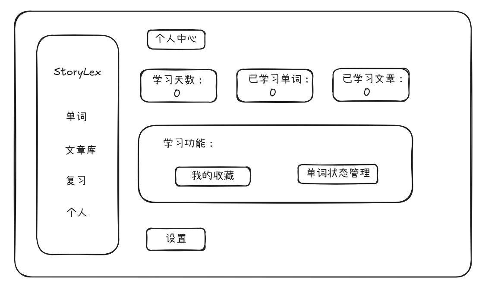

# 语境单词 APP 需求文档 1\.2

# 一、产品核心逻辑

本产品采用“语境阅读 \+ 系统背诵”双模式：

- **语境阅读**：正文以故事、小说、网文形式呈现，中文里夹杂高亮英文生词。用户在阅读中点击生词查看释义，支持标记“收藏”或“已掌握”；读完全文后可开启当堂测验。

- **系统背诵**：用户按选定词书（四级、六级、考研等）进行“英选中”四选一测试，以每组最多 10 词闭环刷题过关；按当日目标和词书剩余数量允许不足 10 词的小组。

- **数据同步与互通规则**：

    - 背完一组词：小结页支持“去练习”、一键“AI生成故事”，练习刚学过的词 或者 生成包含这组词的中英混排短文存入文库；

    - 读完一篇文章：未收藏的词仅算作阅读记录；**只有文章课后“去练习”中做错的词会自动同步至次日艾宾浩斯复习队列；收藏只保存到收藏夹，可自主练习，不加入或改变正式复习排程**。

# 二、适用群体

本产品适用于英语备考学生、日常英语学习者，尤其是英语基础不好、不太愿意背单词、感觉传统背单词很枯燥的人。 

用户有背单词、积累词汇的需求，但传统背单词软件故事死板枯燥，希望依托故事/网文/小说语境记单词，同时需要手机、平板、网页多端同步学习。

# 三、使用场景

1. **手机端碎片化学习**：随时打开 APP，利用碎片时间阅读一篇中英夹杂的短文，或者按组快速刷 10 个单词。

2. **网页端沉浸学习**：在电脑大屏进行故事、文章沉浸阅读，结合右侧生词悬浮栏集中记词。

3. **小说阅读中无痛记词**：阅读中文小说网文，遇到关键情节中的高亮单词，点击即可查看单词的意思，读完全文顺手做个小测验。

4. **系统性背词与故事生成**：选择词书按组背诵，背完一组单词后，让 AI 把这 10 个词串成一篇故事巩固记忆。

5. **本地文档导入转换**：把自己喜欢看的文章、故事、小说 TXT 导入系统，系统自动把属于考研或六级的词语替换成英文生词来读。

6. **艾宾浩斯精准复习**：针对系统背词已结算词和阅读测试错词进行规律性抗遗忘复习；收藏词仅供自主练习。

# 四、用户痛点与解决问题

1. **传统背单词脱离语境、故事枯燥**：传统软件例句呆板，本产品依托故事、小说、网文，在剧情中顺带理解词义。

2. **纯英文阅读门槛太高、查词繁琐**：直接读全英文外刊太痛苦；本产品采用中文大背景夹杂英文单词（中英混排），既保留阅读感，又降低认知负荷。

3. **市面软件功能臃肿干扰多**：去除课程、商城、社交圈等冗杂模块，回归“读故事”与“刷单词”轻量工具属性。

4. **语境阅读与词表背诵割裂**：采用 阅读记词 与 系统刷词 双模式，阅读测试错词进入正式复习；收藏词可在收藏夹自主练习。

# 五、行业同类软件参考

- **百词斩**：分组图像记忆，但缺乏长文本连贯语境，复习灵活性较弱。

- **墨墨背单词**：艾宾浩斯算法精准，但模式偏硬背，缺少趣味阅读情境。

- **扇贝单词 / 不背单词**：功能成熟但机制较复杂，原生阅读多为全英文新闻，对基础薄弱者难度大。

- **StoryVocab：**排版过于复杂、网页内容不够清晰。

- **WordNov：**只看阅读文章，不能系统背诵，也没有练习机制。

- **本产品优势**：主打中英混杂故事、小说语境，轻量级，支持 AI 组词编故事及本地小说替换。

# 六、详细功能说明

#### 首页与任务入口

- **今日任务**：

    - 显示“新学 X 词”与“复习 Y 词”两个卡片入口，并配有当日完成进度条。

    - 点击“开始学习”进入系统背单词界面。

- **继续阅读**：展示最近在读的文章，显示文章标题、生词数及“继续阅读”入口。

#### 系统背单词界面（10 词闭环四选一）

- **交互布局**：

    - 顶部进度条显示组内进度（如 `0/10`），右上角提供“收藏”与“熟（标记已掌握）”按钮。

    - 中间呈现英文单词、英/美音标、发音播放按钮。

    - 下方提供 A、B、C、D 四个中文释义选项，以及底部的“看答案”按钮。

- **做题与判定逻辑**：

    - **选对**：选项变绿，界面直接展开该词的详细中文释义与例句，底部出现“下一词”按钮。点击“下一词”，顶部进度条步进（如 `0/10` 变为 `1/10`），该词标记为本轮通过。

    - **选错**：选项变红并高亮正确选项，展开详细释义与例句，底部出现“下一词”。点击后进度条**不增加**，该词标记为“当堂未通过”，并计入错题重测队列。

    - **看答案**：按答错逻辑处理，展开释义且不增加进度。

- **组内 10 词闭环重测**：

    - 初始 10 词测完一遍后，系统自动打乱前面答错的词重新出题，直到本组每个词全部答对一次或主动标记为已掌握方可过关；进度分母使用实际组内词数（例如 `5/5`）。

- **组结小结与课后操作**：

    - 本组通关后进入“小结”页面，陈列本组单词及释义，右上角可一键“显示/隐藏释义”便于遮挡自测\(\)。   

    - 展示每个词的做题表现（如一次通过、错 1 次等）。

    - 底部提供两个操作：

        - **“生成故事”**：调用 AI 将这组单词编排为一篇爽文/网文短文并存入文库；

        - **“去练习”**：进行当堂即时巩固测试（四选一中英互选）。

    - 结算完成后，单词正式写入艾宾浩斯复习总计划，随后自动进入下一组，直至完成当日目标。

#### 语境阅读模块

- **正文排版**：以中文网文/小说为主排版，大纲考点词与生词以高亮英文形式嵌入（如：*flustered*）。

- **释义显示模式**：

    - 默认隐藏中文释义；

    - 顶部提供“显示/隐藏中文释义”切换开关，开启后中文释义紧跟在英文后方（如：*flustered（手忙脚乱的）*）；

    - PC/网页端适配：右侧提供可折叠的生词速查栏，点击正文单词时，光标可以自动定位。

- **点击查词与状态标记：**

    - 点击高亮英文弹出释义浮层，优先显示当前选定词书（四级/六级/考研）的释义，并打上对应词书标签；超出范围打上 \[超纲\] 标签。

    - 浮层内设操作：

        - **“收藏”**：仅放入收藏夹，可自主练习，不影响正式复习排程；

        - **“熟/已掌握”**：点击后该词正文高亮变淡，底层标记为已掌握，退出正式新学和复习出题；主动重置后才可重新学习。

- **全文词表**：顶部常驻“词表”按钮，可以展示本文全部单词及其学习状态，支持一键切换隐藏/显示释义。

- **阅读结算流程**：

    - 底部提供两个按钮：“完成阅读”与“去练习”。

    - 点击“完成阅读”：已学习文章数 \+1，正文中未收藏的词不强制打入复习队列。

    - 点击“去练习”：提取全文生词进行当堂四选一测验；**仅测验中答错的生词自动转入次日艾宾浩斯复习列表；收藏操作不触发入队**。

#### 文章库与内容生成

- **文章库分类**：顶部支持关键字搜索；界面分“我的书库”（标签：全部、导入、AI 生成、收藏）与“系统推荐文章”。

- **本地 TXT 导入与转换**：

    - 右上角提供“本地导入”按钮，支持上传本地中文 `.txt` 文件。

    - 用户选择目标词书（四级/六级/考研），系统自动检索文档中的对应中文词并替换为英文生词，生成中英混排小说存入“我的书库\-导入”中。

- **AI 故事生成**：

    - 入口：背词小结页、单词收藏夹。

    - 流程：勾选单词 \-\> 选择故事类型 \-\> AI 生成中英混排故事 \-\> 用户预览编辑 \-\> 保存至文库。

#### 单词收藏夹与复习管理

- **收藏夹**：

    - 集中管理手动收藏的生词，支持多选批量操作（批量取消收藏、批量 AI 生成故事）。

    - 支持使用收藏夹内单词进行专项巩固测试，该测试属于临时巩固，不影响系统正式的艾宾浩斯算法排程。

- **复习模块**：

    - 汇集所有达到复习周期的词（含系统背词旧词、阅读测试错词，不因收藏新增复习词）。

    - 提供“今日复习”与“开始今日复习”入口，支持移出复习队列与重置掌握状态。

#### 个人中心

- 展示学习天数、已掌握单词总数、已阅读文章总数。

- 提供当前主修词书切换（四级、六级、考研等）、账号登录与数据云同步设置。

# 七、界面设计

#### 首页

*功能说明*：作为进入 APP 的第一视觉，包含顶部“今日任务”（新学 10 词、复习 10 词及修改目标按钮）和底部“继续阅读”最近文章卡片。

#### 文章库

*功能说明*：顶部带搜索框与“本地导入”按钮；中部为“我的书库”（全部、导入、AI 生成、收藏），下方为“系统推荐文章”列表。

#### 背单词 \- 四选一出题界面

*功能说明*：上方展示单词、音标、发音按钮及进度条（0/10），右上角设“收藏”与“熟”；中间展示 A、B、C、D 四个中文释义选项；底部常驻“看答案”。

#### 背单词 \- 详细解析界面

*功能说明*：无论答对、选错还是点击“看答案”，均停留在该详细解析界面，展示具体词义与例句，点击底部“下一词”后继续做题。

#### 单词小结界面

*功能说明*：10 词闭环通关后展示，列表呈现本轮单词及释义，右上角可一键“显示/隐藏释义”，底部提供“生成故事”与“去复习（去练习）”入口。

#### 语境阅读界面

*功能说明*：展示中英混杂的正文排版，英文生词默认高亮；顶部提供“隐藏中文释义 / 显示中文释义”切换开关及“词表”入口；底部提供“完成阅读”与“复习（去练习）”按钮。

#### 艾宾浩斯复习

*功能说明*：展示“今日复习”单词列表、一键“开始今日复习”按钮，以及下方“已移除单词”管理区域。

（此界面 暂无。。。）

#### 个人中心

*功能说明*：展示学习天数、已学单词数、已读文章数统计卡片，以及“我的收藏”、“单词状态管理”和系统设置入口。

## 第一批已确认的学习规则（2026-10-16）

以下规则适用于正式系统新学和复习；第二批阅读练习规则见文末。

- 题组、选项、正确答案、错题次数和通过状态由后端持久化。刷新或多端请求继续当前用户、词书、当天的活动题组。
- 每组最多 10 词，按当天目标剩余数量和词书剩余可学词数缩减；目标 15 词时分为 10 词和 5 词。已有活动题组不因修改目标而截断，新目标对下一组生效。
- 前端提交题组编号、题目版本和选项，后端判题；看答案算未通过并增加一次错题次数。错词重新打乱选项、生成新题目版本，直至每词至少答对一次。
- 组内点击“熟”直接通过该词并保存已掌握状态；结算不覆盖已有掌握状态或正式复习排程。标熟本身不增加新学数，所在新学组结算时统一计数。
- 正式新学只允许全部通过后结算；重复、并发结算只记一次。题组实际词数就是本组进度分母，不强制 10/10。
- 每次答题携带唯一 request_id。同一次网络重试保持编号和请求内容不变；真正的新作答使用新编号。重复请求返回原回执，不重复计错、计数或推进阶段；同编号不同内容拒绝。
- 正式复习每个词本次只答一次（答错/看答案安排次日再复习），每日同一词最多增加一次今日复习数。答题时后端统计，组结束接口只查询结果，不接受客户端数量累加。
- 全部学习日期和排程使用北京时间。新学结算及复习答错从次日 00:00 到期；复习答对按既有阶段间隔（阶段 1～6 分别为 2、4、7、15、30、60 天）安排到期日 00:00，阶段 7 标记已掌握并退出队列。
- 午夜后旧题组不再接受新的答题和结算，请重新获取当天题组；已经处理成功的请求仍可读取原回执，已结算组仍可读取原结算结果。
- 历史学习数据和排程不批量重写；以上规则自新版请求生效。上线当天既有统计继续保留。
- 收藏及取消收藏只改变收藏夹；收藏夹自主练习不改变正式学习记录、排程或今日正式复习数量。

## 第二批阅读闭环规则（2026-10-17）

- 本章词表展示全部内嵌单词、音标、释义、已学/未学、收藏和掌握状态，按正文顺序展示。详情与词表使用相同数据规则。
- 释义优先当前主修词书，缺失则回退文章目标词书、其他词书；提供释义来源和是否超纲。完全没有释义的词仍展示在词表，但不参与四选一测验，并告知跳过的单词。
- 阅读练习可直接进入，不强制先点击“完成阅读”；练习覆盖本文有可用释义的全部单词，每词一题，后端保存题目并判分。阅读练习使用英选中四选一。
- 前端一次提交全部题目的选择，后端计算0～100整数分，保存最近阅读练习得分。看答案按答错处理，不由客户端上报对错。
- 未提交练习当天可刷新恢复；跨日或切换词书后重新获取。练习完成后可重新生成一份自主练习。
- 同一练习重复或并发提交只结算一次，不能通过修改答案覆盖成绩。已结算练习重复请求返回原成绩，不重复处理错词。
- 阅读测验答对词不新建正式学习记录；新错词阶段0，从北京时间次日00:00进入正式复习。
- 已在学习的错词保留阶段、状态和熟练度，记录一次错误，复习时间只可提前至次日零点，不推迟更早的到期时间；已掌握词保持掌握，不因自主练习答错自动重置。
- 超纲错词可通过其他词书释义进入正式复习，不因当前主修词书没有该词而从复习队列消失。
- 阅读练习不改变已阅读状态、首次完读时间、今日新学数及今日正式复习数。完读必须由用户手动点击。
- 收藏只保存到收藏夹，收藏页自主练习不影响正式复习；本文阅读练习错词入队与收藏功能无关。

## 第三批页面与统计规则（2026-10-17）

- 首页返回今日新学、复习目标和实际数量、是否达标、能否进入任务及最近继续阅读文章。任务按北京时间划分，切换词书不重置今日数量。
- 无到期词时不再显示可开始复习；已有未结束题组时允许继续。没有词可学与已完成目标是不同状态。
- 继续阅读依赖前端主动保存阅读位置，不以练习或通用updated_at推断；未保存过或文章已手动完读时不展示继续入口。
- 阅读进度保存百分比、去除word标签后的正文字符偏移和北京时间；允许回读。通过版本校验避免多端旧请求覆盖新位置。
- 滚动到100%不自动标记已读，仍由用户手动点击。查看/保存阅读位置不新增复习词、不增加正式学习数或学习天数。
- 个人中心同时提供全局已学词数和已掌握词数；已学表示存在学习记录，已掌握是其中mastered子集。已读按已完读文章去重。
- 累计学习天数为正数每日学习统计、学习记录首次创建日期、首次完读日期、阅读练习成功提交日期的并集，不使用连续打卡天数代替；历史无记录的活动不能补推。
- 词书列表展示实际词量及个人在每本词书的学习进度；共享词的状态跨词书沿用。切换主修词书保留历史学习、收藏、阅读记录和正式复习安排。
- 个人统计为全局，词书进度仅统计所选词书，不能将全局已学数直接除以当前词书总量。
- 收藏夹支持分页列表及批量取消，仅移除本人收藏，不影响正式学习记录和排程；重复取消不报错。
- AI预览编辑、TXT导入、文章收藏/分类完善、复习状态重置等尚未在第三批实现，保留后续开发。

## 第四批AI预览、编辑和保存规则（2026-10-17）

- 从小结或收藏夹选择2到20个词、指定主题生成故事时，仅创建个人草稿；用户预览编辑并主动保存后才进入文库。
- 生成任务以用户和request_id防重复；相同参数重试不重复调用模型。生成中可查询草稿状态，失败时显示可读错误，不创建半成品文章。
- 模型生成正文必须包含全部目标单词；标签使用词库原词，不作词形变形。编辑可删除部分词，但必须保留至少一个有效目标词标签，删除的词需在预览结果中明确列出。
- 预览可编辑标题和完整正文，采用版本校验防止多端旧修改覆盖新版本。正文只支持文本及系统word标签，不接受其他HTML或不匹配的词ID。
- 保存时，词表从最终正文有效标签提取，按首次出现顺序去重；删除的词不留在词表，重复标签只计一个唯一词。单独提供标签总出现次数。
- 同一草稿只能保存一次，重复/并发点击或网络重试返回原文章；保存失败时文章和词表事务一起回滚，不留下部分数据。
- 草稿仅本人可查看、编辑、保存。绑定生成时的目标词书，后续切换词书不改变该草稿。
- 草稿不进入文库、阅读记录或个人已读统计；保存也不自动收藏、入复习队列或标记已读。
- 已保存内容不通过草稿接口继续编辑；正式文章二次编辑和TXT导入留待后续。

## 第五批TXT导入规则（2026-10-17）

- 上传中文.txt并选择目标词书后，仅生成可编辑的个人导入草稿，不调用模型；用户确认后存入“我的书库—导入”。
- 支持UTF-8、带BOM的UTF-16、GB18030/GBK。每文件最大200KB，正文最多40000字符，长篇需先分章；本批不做自动分章。
- 从目标词书释义拆取2～12字中文义项，从左向右优先匹配同位置长词；同义项多候选时选择词书排位最靠前的英文，并在预览中列出候选ID。
- 默认最多替换20处、替换之间保留至少30个原文字符，可调整；只做字面匹配，不判断语境。用户应在预览检查多义词和阅读流畅度后保存。
- 无匹配词时提示更换词书或正文，不生成无单词标签草稿。原文中自带标签按普通文字转义，不允许伪造词ID。
- 支持预览查询、编辑、版本冲突校验及防重复保存，复用AI草稿接口和已有表；无需新增迁移SQL。
- 保存来源为imported；保留规范化后的原始中文source_content，最终混排正文和实际词表同步保存。词表按首次出现顺序去重，同词多处出现另计标签总次数。
- 导入和保存不改变收藏、正式学习或复习排程，不自动标记完读或增加学习数量。

## 第六批文章库与文章收藏规则（2026-10-17）

- “我的书库”展示本人创建的导入/AI文章及本人收藏的系统文章；“系统推荐”展示内置文章。默认全部列表仍展示所有可访问文章，兼容现有接口调用。
- 分类支持全部、导入、AI生成、收藏；支持标题关键词搜索和分页。分类、来源、书库范围、关键词组合时取交集。
- 收藏系统文章不复制内容，只新增用户与文章的收藏关系；取消后从我的书库移出，但系统推荐仍可访问。
- 自己创建的文章无论是否收藏都留在我的书库。收藏列表只显示当前用户收藏；不允许访问或收藏其他用户私有文章。
- 收藏接口明确传true或false，重复操作不反转状态、不产生重复记录。列表及详情显示文章收藏状态。
- 文章收藏独立于单词收藏、学习和复习，不自动完读或改变任何学习统计。

## 第七批收藏夹与小结自主练习规则（2026-10-17）

- 收藏夹可勾选1到20个本人收藏词生成专项练习；小结可选择本人已学词，提供新学组编号时校验为本人已结算组内的词。
- 支持英选中、中选英和混合题型；混合在至少2词时包含两种题型，单词数较少时每词仅一题。只有1词时默认英选中。
- 四选一选项来自真实词库、互不重复。释义优先当前主修词书，缺失则回退其他词书；缺失释义或词库不足以生成干扰项时明确提示。
- 题组、选项及正确答案由后端保存，客户端只提交选择。中选英题干不额外暴露英文原词、音标或答案解析；提交后统一返回得分、错词和详细解析。
- 题组可查询恢复，允许跨日完成。生成后取消收藏、切换词书不影响已有快照，新生成仍校验当前权限。
- 重复生成请求使用原request_id返回原题组，重新练习使用新编号；每份练习只结算一次，重复提交不改变原成绩。
- 收藏夹和小结练习只用于临时巩固，不更改正式学习/掌握状态，不写错词复习排程，不增加今日新学、今日正式复习或累计学习天数；阅读课后练习错词入队仍保持原规则。

## 第八批复习状态管理规则（2026-10-17）

- 正式复习支持暂停、查看已暂停列表和恢复；暂停状态独立于learning/reviewing/mastered，不误算为掌握，不删除学习记录。
- 暂停保留阶段、熟练度、历史错题和复习次数；不出现在正式复习队列或首页到期数量里。活动复习组中未答的暂停词直接跳过，不增加今日复习数。
- 阅读练习答错不会自动恢复暂停词或修改其排程；收藏与自主练习仍可正常使用，均不影响暂停状态。
- 恢复从北京时间次日00:00起重新复习，阶段和熟练度沿用；不把词塞回旧题组，重复恢复不推迟到期时间。
- 已掌握词支持主动重置，改为reviewing、阶段0、熟练度0，次日00:00开始复习。保留历史学习记录和统计，不重置今日已复习去重计数。
- 标记掌握会清除暂停状态；掌握状态与暂停状态不会同时作为有效状态显示。重置掌握也会清除暂停标记。
- 三类修改均用request_id保存操作回执，网络延迟或重复请求不再次执行；同编号不能改变操作或单词。旧回执仅代表原操作结果，当前状态应重新查询。
- 词书列表和文章内嵌词表显示is_review_paused，暂停列表支持本人全局分页；不影响全局已学词数、收藏或阅读记录。
